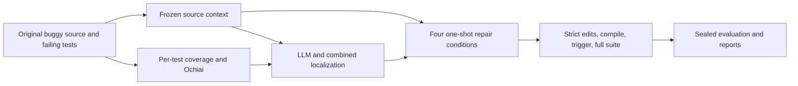

# DebugLab

LLM-assisted fault localization and automated program repair for real Java bugs.
DebugLab compares spectrum-based localization, LLM localization and their
combination, then generates one patch per repair condition and validates it with
Java compilation and the complete Defects4J test suite.

## Results

The **selected evaluation set** contains 60 bugs from Lang, Math, Chart and Time.
The completed evaluation used Qwen2.5-Coder 7B for 360 model calls and 240 one-shot
repair attempts. It produced **14 test-plausible condition/bug pairs across four
unique bugs**. Passing the available tests does not prove semantic correctness.

| Condition | Plausible / 60 | Overall rate | Plausible / 50 retrieval-eligible bugs |
|---|---:|---:|---:|
| Direct | 3 | 5.0% | 3 / 50 (6.0%) |
| Spectrum-guided | 3 | 5.0% | 3 / 50 (6.0%) |
| LLM-guided | 4 | 6.7% | 4 / 50 (8.0%) |
| Combined-guided | 4 | 6.7% | 4 / 50 (8.0%) |

Repair eligibility requires **all true faulty methods to be present in the
retrieved context**. The ten other bugs remain in the overall denominator.
Method Top-1 accuracy is 21.7% for spectrum, 35.0% for LLM and 40.0% for combined
localization. See the [final summary](results/final/SUMMARY.md),
[full report](results/final/REPORT.md) and [CSV tables](results/final/).

The set was used for tuning. These results are not independent evidence of
generalization, and sparse repair successes do not establish causality.

## Pipeline



For each bug, two model calls localize the fault and four calls generate patches:
direct repair without a localization hint, spectrum-guided repair, LLM-guided
repair and combined-guided repair. All four conditions share exactly the same
original source context and failure information; only the hint varies.

## Install

Use Python 3.11 on macOS or Linux. Git, Java, benchmark dependencies and model
weights are installed separately. This repository does not include those tools
or benchmark checkouts.

```sh
git clone https://github.com/AanshDevpura/debuglab.git
cd debuglab
python3.11 -m venv .venv
source .venv/bin/activate
pip install -r requirements-lock.txt
pip install --no-deps -e .
```

The lock file pins the validated Python application and development dependencies.
The tokenizer is downloaded on first use and then cached. Unit tests mock model
generation and do not need a running model or old experiment artifacts.

### Defects4J and Java

Install Java 11, Git, Subversion, Perl and `cpanm`. Set `JAVA_HOME` to your Java 11
installation and put its `bin` directory on `PATH`. Follow the
[official Defects4J installation requirements](https://github.com/rjust/defects4j#setting-up-defects4j)
for the platform prerequisites. The evaluated benchmark version is 3.0.1.

From the repository root:

```sh
mkdir -p work/tools
git clone https://github.com/rjust/defects4j.git work/tools/defects4j
(
  cd work/tools/defects4j
  cpanm --installdeps .
  ./init.sh
)
source scripts/env.sh
java -version
defects4j info -p Lang
```

Check that the installed Defects4J checkout reports version 3.0.1 if reproducing
the published evaluation. `configs/local.json` and the integration fixtures expect
the executable at `work/tools/defects4j/framework/bin/defects4j`. A different
installation can be supplied through a copied configuration for experiment runs.
The integration tests use the documented local tools location.

`scripts/env.sh` optionally discovers workspace-local tools and sets the benchmark
timezone to `America/Los_Angeles`. Always run native tests and experiments in that
timezone. Check that sourcing it has not selected a different Java installation.

### Coverage dependencies

The coverage runner requires the JaCoCo 0.8.12 runtime agent and command-line JARs
at these filenames. Download them from Maven Central:

```sh
mkdir -p work/tools/jacoco
curl --fail --location \
  https://repo.maven.apache.org/maven2/org/jacoco/org.jacoco.agent/0.8.12/org.jacoco.agent-0.8.12-runtime.jar \
  --output work/tools/jacoco/agent.jar
curl --fail --location \
  https://repo.maven.apache.org/maven2/org/jacoco/org.jacoco.cli/0.8.12/org.jacoco.cli-0.8.12-nodeps.jar \
  --output work/tools/jacoco/cli.jar
```

`java/SpectrumRunner.java` uses JUnit and JaCoCo to collect per-test executable-line
coverage. Its compiled classes are generated locally under `work/tools/jacoco`.

### Local model

Install and start [Ollama](https://docs.ollama.com/quickstart), then run:

```sh
ollama pull qwen2.5-coder:7b
ollama create debuglab-qwen-coder-32k -f configs/ollama-7b.Modelfile
ollama show debuglab-qwen-coder-32k
```

`configs/local.json` targets the OpenAI-compatible endpoint
`http://127.0.0.1:11434/v1`. The evaluated settings are a 32,768-token context,
4,096-token output, 512-token safety reserve, temperature 0, seed 20261009 and one
sample per repair condition. Input prompts must fit 28,160 tokens. An authenticated
compatible service can read its key from the `DEBUGLAB_API_KEY` environment
variable; do not put credentials in configuration files or commit `.env` files.

Pulling a model by tag may obtain different weights later. Exact replay also
requires the original weights, tokenizer and chat template. The evaluated weight
blob was `60e05f2100071479f596b964f89f510f057ce397ea22f2833a0cfe029bfc2463`.

## Verify the installation

Portable checks, also run by GitHub Actions:

```sh
ruff check .
ruff format --check .
pytest -q -m 'not integration'
scripts/check-release
```

After installing Java, Defects4J and the coverage dependencies:

```sh
source scripts/env.sh
scripts/verify
```

The validated suite has 61 portable tests and two native integration tests. The
native tests use real Java/Defects4J; no model generation is needed. Local runtime
logs and caches remain ignored. GitHub Actions runs the portable suite only.

## Reproduce the selected 60-bug evaluation

Run commands from the repository root with the virtual environment active and
`scripts/env.sh` sourced. A full study involves real benchmark test suites and 360
local model calls; plan for a long-running job. Do not run two workers or
coordinators against the same output directory.

### Fresh run from a clone

`configs/split.json` contains the original selected evaluation set. Its internal
partition keys are execution-order groups, not independently reported datasets.
The driver runs the initial 12 bugs, verifies the implementation, and then runs
the remaining 48. Report all 60 together.

Create an ignored configuration with new work/output paths so a new run cannot
overwrite the published run or its cached calls:

```sh
python - <<'PY'
import json
from pathlib import Path

path = Path('configs/reproduce.local.json')
if path.exists() or Path('outputs/reproduce').exists() or Path('work/reproduce').exists():
    raise SystemExit('Choose unused configuration, output and work paths for a new run')
config = json.loads(Path('configs/local.json').read_text())
config.update(
    work_root='work/reproduce/bugs',
    output_root='outputs/reproduce/runs',
    freeze_path='outputs/reproduce/frozen.json',
    pilot_baseline_path='outputs/reproduce/recall-baseline.json',
)
path.write_text(json.dumps(config, indent=2) + '\n')
PY

python -m debuglab.driver --config configs/reproduce.local.json
python -m debuglab_gold.large_report --config configs/reproduce.local.json
```

The ordinary pipeline prepares buggy checkouts, coverage, failure evidence and
contexts from Defects4J. This route does not require any historical data bundle.
Its regenerated contexts or model responses may differ from the published run;
report its actual outcomes rather than selecting a preferred sample.

To run one selected bug instead, use an unused configuration prepared as above
and run the following command **instead of** starting the full driver:

```sh
scripts/debuglab run --bug Chart-25 --config configs/reproduce.local.json
```

### Exact frozen-context replay with the local data bundle

Exact replay requires the separately retained `work/final-baseline` debugging-input
bundle. It is intentionally not distributed in Git. The public reports can be read
without it. If this bundle is available, create the new configuration above and
prepare its protected-input ledger before starting the cohort coordinator:

```sh
python - <<'PY'
import hashlib
import json
from pathlib import Path

baseline = Path('work/final-baseline')
bugs = json.loads(Path('configs/split.json').read_text())['pool']
if not all((baseline / bug / 'context.txt').is_file() for bug in bugs):
    raise SystemExit('The original 60-bug debugging-input bundle is required')
root = Path('outputs/reproduce')
root.mkdir(parents=True, exist_ok=True)
ledger = root / 'baseline-artifact-hashes.json'
if ledger.exists():
    raise SystemExit('Preserve the existing ledger; do not reset a run')
ledger.write_text(json.dumps({
    str(path): hashlib.sha256(path.read_bytes()).hexdigest()
    for path in sorted(baseline.rglob('*')) if path.is_file()
}, indent=2) + '\n')
PY

python -m debuglab.cohort_run --config configs/reproduce.local.json \
  --baseline work/final-baseline --reuse-context
```

This coordinator verifies native tests and the input ledger, freezes the source,
configuration and selection, reuses only original debugging inputs, and audits the
completed calls and full-suite proofs. It never copies saved answers into new
model calls. Comparison reads the baseline results separately after generation and
rejects context changes by default. Source archives and fingerprints remain local.

### Outputs and resuming

For either route, reports are written under `outputs/reproduce`, with individual
bug directories under `outputs/reproduce/runs`. Each bug directory contains:

- `context.txt`, `context-manifest.json`, methods, failures and spectrum evidence;
- `calls/` with request parameters, exact token counts and saved responses;
- `mapped-edits/` and `evaluation-logs/` with canonical patches and native proofs;
- `result.json` with localization metrics and repair outcomes.

The driver/coordinator saves progress and can resume the same configuration.
Inspect processes and logs first. Never delete a fingerprint, change configuration
mid-run, overwrite a call cache, or treat an interrupted call as permission to
resample. Completed calls are immutable; failed outcomes remain counted.

## Evaluation protocol

- **Population:** the same 60 selected bugs, selected using pre-model eligibility.
  No bug is excluded because of a model or repair outcome. The whole selected
  evaluation set is the primary reporting population.
- **Retrieval:** original source, failing-test text, stack frames, lexical
  relevance, an unranked executed-method set and conservative call proximity.
  Retrieval does not access suspiciousness scores or known fixes. Whole methods
  and compact class declarations are packed using exact tokenizer counts.
- **Localization:** spectrum/Ochiai, LLM-only, and spectrum-informed LLM rankings.
  Report method and line Top-1/3/5. Ties receive mean rank; evaluation takes the
  best rank over true faulty locations. Unranked faults have infinite rank;
  ranked-only means are labeled separately. Changed/deleted buggy lines define
  line eligibility; insertion-only fixes remain method-eligible. Unmapped
  class-scope faults remain in the method denominator.
- **Repair:** one generated patch per condition, with at most three canonical
  original-source method edits. No compiler/test feedback revision, repeated
  sampling, best-of selection, manual patch correction or parser relaxation.
- **Validation:** parse/apply, Java syntax, native compilation, triggering tests,
  then the complete suite. Plausibility requires `defects4j test` without `-t`,
  return code 0, no timeout and a final `Failing tests: 0`. Exit code 0 alone is
  insufficient. Invalid outputs, compile failures, test failures, model errors
  and timeouts all remain in the denominators.
- **Ground truth:** fixed source and diffs are isolated in `debuglab_gold`.
  Generation never receives gold, repository tools or native feedback. A separate
  subprocess audits leakage and evaluates saved outcomes.
- **Conditional analysis:** localization also reports the 54-bug subset with at
  least one faulty method retrieved. The summary's stricter repair subset has
  all faulty methods retrieved (50 bugs). These supplement the 60-bug results.

## Key design decisions and limitations

The evaluated configuration uses the existing local 7B model, Java source/type
guidance, string replacements, ordinary context allocation and unrestricted line
choices. Optional balanced retrieval, class-member editing, line-array edits and
strict executable-line hints remain disabled. Their implementation is retained
where it supports compatibility or tests, without claiming they improve this run.

The four repair conditions share frozen source bytes and failures. Hashes protect
source/configuration/selection and cached calls. Monotonic deadlines propagate
remaining native-process budgets; cleanup preserves logs while removing disposable
checkouts. This does not promise identical behavior across host suspend semantics.

This selected evaluation set was used for tuning, so the study cannot establish
independent generalization. Greedy seeded service calls are not guaranteed to be
bitwise deterministic. Stronger method rankings did not translate into substantial
repair gains; plausible patches may still overfit the test suite. Missing context,
unmapped class-scope faults, insertion-only fixes and conservative overload
resolution also limit interpretation.

## Repository layout

| Path | Purpose |
|---|---|
| `src/debuglab/cli.py` | Command-line entry point for individual runs and reports |
| `src/debuglab/pipeline.py` | Per-bug preparation, localization, patch generation and validation |
| `src/debuglab/cohort_run.py` | Frozen-context cohort replay, audits and report publication |
| `src/debuglab/driver.py`, `study.py` | Selected-set execution, progress, deadlines and resume |
| `src/debuglab/source.py`, `retrieval.py` | Java indexing and source-context construction |
| `src/debuglab/model.py`, `interface.py` | Prompts, token accounting, immutable calls and method handles |
| `src/debuglab/spectrum.py`, `java/SpectrumRunner.java` | Coverage collection and Ochiai rankings |
| `src/debuglab/edits.py`, `harness.py` | Safe patch application and native test execution |
| `src/debuglab_gold/` | Sealed ground-truth evaluation and aggregate reports |
| `configs/local.json`, `configs/split.json` | Evaluated settings and selected evaluation set |
| `tests/` | Portable fixtures and opt-in native integration checks |
| `scripts/` | Environment setup, CLI wrapper, verification and release checks |
| `results/final/` | Compact measured reports, CSVs and audit records |
| `.github/workflows/ci.yml` | Portable verification on pushes and pull requests |
| `work/`, `outputs/` | Ignored local tools, checkouts, raw calls and logs |

Reports, slides and presentation notes are private deliverables and are not part
of this repository. Only compact research results are published. Local toolchains,
model weights, raw benchmark data, credentials and virtual environments are not
tracked. No new model evaluation was performed as part of repository packaging.
