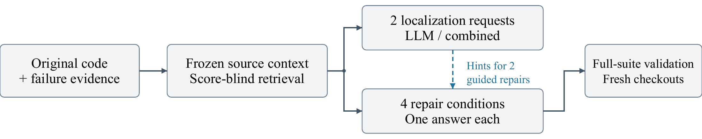
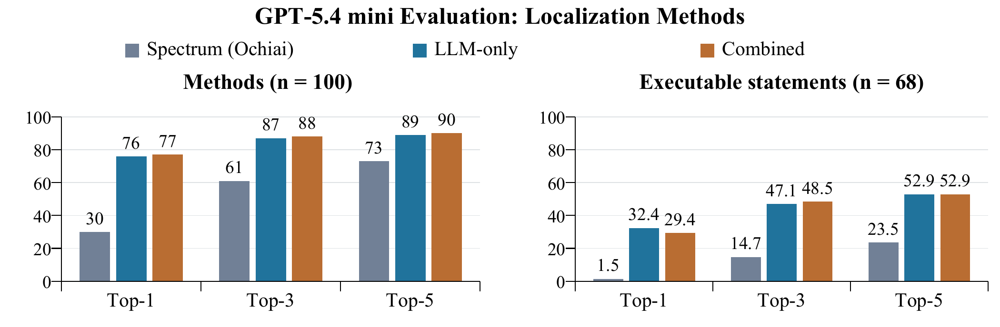
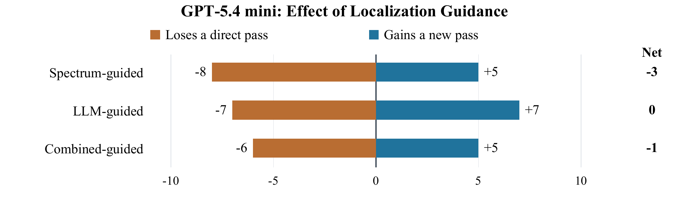

# Does Better Localization Improve One-Shot Program Repair?

A Paired Study of 100 Defects4J Bugs

Aansh Devpura (devpura2) and Theodor Novitsky (theodor4)

## 1 Introduction (Target Problem and Motivation)

Fault localization identifies buggy code; program repair changes it to restore intended behavior. Spectrum-based localization uses passing and failing test coverage, while a large language model (LLM) interprets source and failure evidence. Combining these signals may improve diagnosis, but a repair must also preserve other behavior.

We ask: RQ1, how do spectrum-based, LLM-only and combined localization compare? RQ2, do their hints improve one-shot repair (one answer without feedback or revision) over direct generation? RQ3, how does a stronger model compare with a weaker model given the same source context? We contribute a controlled pipeline and paired measurements of localization accuracy, test plausibility and reference-based patch assessment. The code and study data are available in our repository [1].

## 2 Related Work

Combining localization evidence. Zou et al. train RankSVM, a supervised machine-learning ranking model, to combine scores from seven localization families, including coverage, mutation and program-dependency evidence [2]. Training uses known faulty and nonfaulty statements to learn which score combinations should rank faulty code higher. Across 357 faults, their Top-1 measure shows that the combination ranks a faulty statement first for 72, versus 24 for the best individual technique. This supports combining complementary signals, but does not show that adding coverage ranks to an LLM prompt improves either localization or repair, which we test.

LLM-based localization. Kang et al.’s AutoFL lets an LLM inspect covered code, navigate methods and explain a suspected fault [3]. With GPT-3.5, it improves method Top-1 accuracy by 19.7% relative to Ochiai on Java bugs. Ochiai is the spectrum-based baseline that ranks code using passing and failing test coverage. GPT-4 also outperforms five aggregated GPT-3.5 runs with a single run. Our comparison holds retrieved source fixed and tests whether better rankings lead to more valid repairs.

Model capability and context. Xia et al. compare nine models across five repair datasets [4]. On their whole-function Java subset, Codex yields 63 correct fixes versus GPT-NeoX’s 18. Supplying code before and after a missing fragment also improves repair. We extend these model and context comparisons by testing localization hints with identical source and one answer per condition.

Beyond passing tests. Xia et al. judge only 63 of Codex’s 102 suite-passing fixes correct [4], showing that passing the existing tests does not guarantee a valid repair. We therefore report suite passes separately from reference-guided human review, which checks whether patches fix the defect while preserving required behavior.

## 3 Approach and Study Methodology

DebugLab is our evaluation pipeline for localization and repair. It starts from the original buggy program, reproduces failures and collects per-test coverage. Ochiai scores a location as ef / sqrt(F(ef + ep)), where ef and ep count covering failing and passing tests, and F is the total failing-test count. Method scores use method coverage; tied spectrum scores receive mean ranks.

### 3.1 Context control and cohort construction

Retrieval selects complete buggy methods and compact declarations using failures, stack traces, lexical relevance and an unranked executed-method set, not Ochiai scores or developer fixes. Up to two uniquely resolved same-class helpers follow each caller within the existing budget. Methods receive handles and original line numbers; the selected code is frozen across conditions and models.

We select 100 of 134 inspected candidates whose retrieved code contains all known faulty methods and whose developer-provided fix fits at most three complete method replacements and Qwen’s token budgets. Model outcomes do not inform selection; fixed code never enters generation. This checks repair feasibility on a restricted cohort rather than general retrieval performance.

### 3.2 Independent localization and repair requests

We evaluate three rankers: spectrum-only (Ochiai, no LLM), LLM-only (source and failures), and combined (the same inputs plus spectrum ranks). Spectrum is computed directly; the others each require one model call. Methods and executable statements are ranked independently. Model outputs are checked for valid handles, statement starts and duplicates; invalid rankings remain failures.

Figure 1. Solid arrows show source and patch flow. Dashed hints go only to LLM-guided and combined-guided repairs, independently of the shared source input.

The model generates one patch under each of four conditions: direct (no hints), spectrum-guided, LLM-guided and combined-guided. All receive the same source; the last two use their own new localization rankings. A patch replaces one to three complete original methods or constructors, preserving callable interfaces. Added fields, classes and appended helpers are rejected. Hints do not restrict edit locations; consistent parameter renaming is allowed.

### 3.3 Outcomes and comparison rules

Each patch is applied to a fresh buggy checkout, parsed, compiled, run against failure-triggering tests and then the full project suite. A pass requires defects4j test without -t, exit zero, no timeout and a final Failing tests: 0. All failed attempts remain counted. There are no retries, revisions, hand fixes or test feedback. Paired comparisons count guidance’s gains and losses on the same bugs.

### 3.4 From midpoint prototype to final study

The midpoint’s 60-bug prototype exposed missing context, unsupported edits and invalid patches. We added helper context, separate statement rankings, stricter method checks, a feasibility-screened 100-bug cohort, the stronger model and semantic review. Identical supplied code keeps the comparison about using the same information rather than obtaining more through exploration.

## 4 Evaluation (Settings and Results)

### 4.1 Experimental settings

The 100 Defects4J 3.0.1 bugs span JFreeChart (Chart, 19), Apache Commons Lang (Lang, 30), Apache Commons Math (Math, 34) and Joda-Time (Time, 17). All known faulty methods are supplied; 68 bugs have eligible changed/deleted-line targets. Both models receive the same bugs and frozen source. This new cohort is not directly comparable with the midpoint’s 60 bugs.

We compare weaker Qwen2.5-Coder 7B with stronger GPT-5.4 mini (gpt-5.4-mini-2026-03-17) [5]; these labels describe performance here. Both use temperature zero and a 4,096-token output cap. Qwen runs locally with a 32,768-token window, 28,160-token input allowance and seed 20261009. GPT uses the API without a seed or recorded reasoning tokens; its larger window adds no source.

Each model makes 600 requests and 400 repair attempts. Source and failure evidence are identical. The 400 fixed-input messages match across models; 200 repair prompts use each model’s newly generated rankings. Provider-specific request formats preserve the same edit rules and validation.

### 4.2 Results

#### 4.2.1 Localization (RQ1): no consistent gain from combining signals

Top-k measures bugs with a faulty location among the first k candidates (100 eligible bugs for methods; 68 for statements). Invalid and unranked targets are misses with infinite rank. Figure 2 compares GPT’s rankers; Table 1 includes both models.

Figure 2. Spectrum (Ochiai) is the independent baseline; LLM-only and combined use GPT-5.4 mini. Bars show Top-k accuracy (%).

Table 1. Top-1 (%), Qwen → GPT-5.4 mini (change in points); n = 100 methods, 68 statements.

| Ranker | Method Top-1 Qwen → GPT-5.4 mini (Δ pp) | Statement Top-1 Qwen → GPT-5.4 mini (Δ pp) |
| --- | --- | --- |
| Spectrum | 30.0 → 30.0 (+0.0) | 1.5 → 1.5 (+0.0) |
| LLM-only | 48.0 → 76.0 (+28.0) | 5.9 → 32.4 (+26.5) |
| Combined | 42.0 → 77.0 (+35.0) | 4.4 → 29.4 (+25.0) |

Answer to RQ1. Qwen2.5-Coder 7B’s method Top-1 is 48% with LLM-only versus 42% combined; statement Top-1 is 5.9% versus 4.4%. GPT-5.4 mini reaches 76% versus 77% for methods and 32.4% versus 29.4% for statements. At Top-1, both outperform Ochiai (30% methods, 1.5% statements). GPT’s combination gains 7 first-ranked faulty methods but loses 6 through 3 demotions and 3 invalid duplicate rankings; statement gains of 3 are offset by 5 losses. Spectrum hints can misdirect ranking: combination hurts Qwen and adds no consistent GPT benefit.

4.2.2 Repair (RQ2): guidance yields no clear aggregate advantage

With GPT-5.4 mini, direct repair passes 41/100 bugs. Spectrum guidance passes 38 (−3 percentage points), LLM guidance 41 (no change), and combined guidance 40 (−1 point). Figure 3 compares the same bugs: guidance gains some passes but loses others, explaining why better outcomes on individual bugs do not increase the overall pass rate.

Figure 3. Guidance gains and losses for GPT-5.4 mini relative to direct repair on the same 100 bugs. A gain passes only with guidance; a loss passes only without it. Net changes are −3, 0 and −1 bugs.

Answer to RQ2. Hints rank code that is already available; they add neither source nor test feedback. Finding the faulty method is also insufficient: guided repair still fails to pass the suite in 38 of 76 cases where LLM-only ranks it first, and 40 of 77 such combined cases. This points to a patch-generation bottleneck: even a correct method hint often does not produce a passing change. Guidance’s gains are offset by losses in the original suite results (Figure 3); Section 4.2.4 checks whether semantic screening changes this conclusion.

A concrete example. On Time-23, LLM-only and combined both rank the faulty method and statement first. Their repairs edit that method but still fail the triggering tests; the combined patch leaves the faulty time-zone alias mappings unchanged. Direct repair changes those mappings and passes the suite. This shows how correct localization can coexist with an ineffective patch. It does not establish why the model chose that patch.

#### 4.2.3 Model capability (RQ3): stronger versus weaker

Answer to RQ3. The stronger GPT-5.4 mini passes 160/400 attempts (40.0%), versus Qwen’s 43/400 (10.75%): +117 passes, or +29.25 percentage points. The gain appears in every repair condition: +30 points for direct and LLM-guided repair, +29 for spectrum-guided, and +28 for combined-guided (Table 2). Direct repair alone rises from 11% to 41%, so the improvement does not depend on generated localization hints. LLM method Top-1 also rises from 48% to 76% (Table 1). The observed difference between models is substantially larger than the change from adding guidance.

Table 2. Suite-passing attempts on the same bugs: 100 per condition and 400 per model. The final row counts distinct bugs with at least one passing condition, not confirmed repairs.

| Repair condition | Qwen2.5-Coder 7B | GPT-5.4 mini |
| --- | --- | --- |
| Direct | 11/100 (11%) | 41/100 (41%) |
| Spectrum-guided | 9/100 (9%) | 38/100 (38%) |
| LLM-guided | 11/100 (11%) | 41/100 (41%) |
| Combined-guided | 12/100 (12%) | 40/100 (40%) |
| All attempts | 43/400 (10.75%) | 160/400 (40%) |
| Bugs with any pass | 13/100 | 49/100 |

#### 4.2.4 Reference-guided human review

Review procedure. Human review used the developer’s reference (golden) patch and original code to assess suite-passing patches. Exact matches were not required: alternative implementations were accepted if they fixed the defect while preserving required behavior.

Common errors. Passing patches still suppressed exceptions, removed ordering or type checks, ignored input bounds and overflow, or fixed one affected method but left another affected overload unfixed.

Table 3. Patch review outcomes. Each repair condition contains 100 attempts.

| Assessment outcome | Qwen2.5-Coder 7B | GPT-5.4 mini |
| --- | --- | --- |
| Suite-passing attempts | 43 | 160 |
| Defective passing attempts | 13 | 36 |
| Bugs with valid repairs | 9/100 | 39/100 |
| Valid repairs | 30/400 (7.5%) | 124/400 (31%) |
| Direct (no hints) Spectrum-guided LLM-guided Combined-guided | 9/100 (9%) 6/100 (6%) 7/100 (7%) 8/100 (8%) | 30/100 (30%) 32/100 (32%) 31/100 (31%) 31/100 (31%) |

Interpretation. Review reduces Qwen’s rate from 10.75% to 7.5% and GPT’s from 40% to 31%, narrowing the model gap to 23.5 points. GPT’s guided rates (31–32%) remain close to direct repair (30%); LLM and combined guidance tie at 31%. Review preserves the model advantage but reveals little guidance benefit.

## 5 Discussion (Limitations and Future Extensions)

### 5.1 Limitations

Scope and confidence. The cohort excludes missing-context failures and larger fixes, so results do not describe arbitrary Defects4J bugs or new projects. Public benchmark code may appear in training data. The model comparison uses one run per model; provider, tokenizer and seed also differ. Patch review supports validity judgments but cannot prove correctness for every input.

### 5.2 Future extensions

Broader, repeated evaluation. Evaluate more bugs across additional projects, including cases excluded by the current retrieval and edit limits. Compare more models across sizes and families, and repeat each condition across independent runs with declared settings and budgets. This would show whether the model gap and small guidance gains persist beyond one model pair or run. Expand human review of suite-passing patches, using multiple reviewers to check fixes and preserved behavior against developer references while allowing valid alternatives. Report reviewer agreement and investigate disagreements, with targeted tests where needed.

Agentic and iterative repair. Let models search the repository, inspect additional files and dependencies, and revise patches using compiler and test feedback. This could recover information missing from the frozen context, but would not guarantee finding the bug: an agent might never locate the faulty method. The scope would therefore change from repairing identical supplied source to evaluating an end-to-end debugging workflow, in which models and conditions may inspect different code. Compare exploration alone with exploration plus feedback under matched call, token and time budgets, recording inspected source, retrieval failures and final human-reviewed repairs. We excluded this broader workflow because of cost, time and the decision to hold supplied information fixed.

## 6 Conclusion

On the same 100 bugs, GPT-5.4 mini yields 124 valid repairs across 400 attempts, versus 30 for Qwen2.5-Coder 7B. Both improve Top-1 localization over Ochiai, but combining signals adds no consistent gain. GPT’s valid-repair rate rises only from 30% without hints to 31–32% with guidance. Once faulty code is supplied, locating it more accurately does not reliably produce a valid edit. In this setting, choosing the stronger model made a much larger difference than adding localization hints.

## References

[1] A. Devpura and T. Novitsky. “[DebugLab: Code and Study Data.](https://github.com/AanshDevpura/debuglab)” GitHub repository, 2026.

[2] D. Zou, J. Liang, Y. Xiong, M. D. Ernst and L. Zhang. “[An Empirical Study of Fault Localization Families and Their Combinations.](https://damingz.github.io/papers/tse19.pdf)” IEEE Transactions on Software Engineering, 47(2), 332–347, 2021.

[3] S. Kang, G. An and S. Yoo. “[A Quantitative and Qualitative Evaluation of LLM-Based Explainable Fault Localization.](https://coinse.github.io/publications/pdfs/Kang2024ay.pdf)” Proceedings of the ACM on Software Engineering, FSE, 2024.

[4] C. S. Xia, Y. Wei and L. Zhang. “[Automated Program Repair in the Era of Large Pre-trained Language Models.](https://lingming.cs.illinois.edu/publications/icse2023a.pdf)” ICSE, 2023.

[5] OpenAI. “[GPT-5.4 mini.](https://developers.openai.com/api/docs/models/gpt-5.4-mini)” Model documentation; snapshot checked November 2, 2026.
